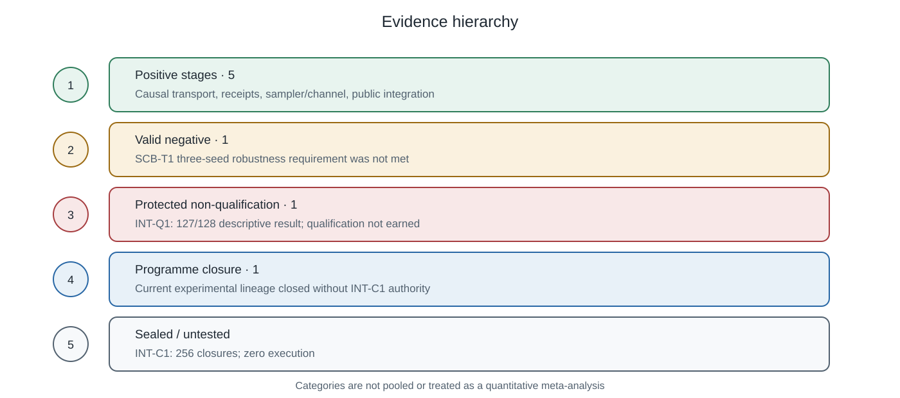

# Appendices

Status: provisional reporting material; no new scientific evidence.

## A. Full experimental chronology

| Stage | Classification | Result |
|---|---|---|
| SCB-T1 | Valid negative | Strict bottleneck recipe passed 2/3 seeds; advancement failed |
| SCB-M1 | Formal positive | Selected-model causal transport confirmed |
| REC-C1 | Formal positive | Exact, abstract, and causal-chain receipts confirmed |
| Initial carrier D0 | Valid operating-point negative | 88/128 pairs; frozen ≥75% gate failed |
| AGG-D0 | Protocol-incoherent closure | History-conditioned randomness contradicted post-divergence common draws |
| RNG2-D0 | Implementation positive | Position-indexed sampler validated |
| First RNG2-CAL1 | Chronology invalid | Raw evidence lacked a valid pre-scoring commitment |
| RNG2 clean calibration | Formal calibration positive | `T=4.041451884327381`, `M=0.0` |
| RNG2-V1 | Formal prospective positive | Generic 16-authority channel validated |
| RNG2-INT-V1 | Formal public positive | Receipt-bound output provenance passed 128/128 |
| RNG2-INT-Q1 | Protected non-qualification plus terminal defect | Descriptive 127/128 |
| Final consolidation | Closed | Confirmation prohibited and sealed |

Historical failures were preserved rather than overwritten by later designs.

## B. Denominators

### Public INT-V1

```text
closures                         128
natural/alias execution packages 256
receipt envelopes                1,280
generated outputs                10,240
model steps                      501,760
primitive authority scores       163,840
aggregate authority scores       20,480
attack packages                  1,024
```

### Protected INT-Q1

Q1 used the same registered denominators. It produced 127 complete closure
successes, one computation-fidelity failure, two dependent attack failures,
zero carrier-off regressions, and zero wrong-authority confusions.

### Protected INT-C1

```text
registered closures       256
registered oriented rows  512
executions                 0
receipts                   0
outputs                    0
detector decisions         0
authorised                 no
```

## C. Frozen gates

A closure succeeded only if both natural and alias sides passed:

- computation fidelity;
- exact receipt;
- abstract receipt;
- causal-chain verification;
- semantic validity;
- authenticated aggregate score `> T`;
- unique authenticated-authority rank;
- margin `> M`;
- carrier-off and wrong-authority controls.

The complete-pair advancement gate was at least 96/128. Gates were
non-compensatory.

## D. Runtime and audit chronology

Claim-bearing runtime:

```text
causal execution
→ issue receipts
→ verify receipts and chain
→ expose authenticated abstract z2
→ derive state authority
→ generate output
```

Prospective audit:

```text
commit receipt and sampler keys
→ release role once
→ execute complete runtime
→ commit primitive evidence
→ reveal keys
→ independently reconstruct
→ audit and stop
```

## E. Protected-Q1 terminal interpretation

Q1's release, execution chronology, denominators, retained evidence, and
independent reconstruction were valid. Scientifically, it failed one
computation-fidelity gate and two dependent attack expectations. The frozen
adjudicator had only a positive official gate and lacked an appropriate
scientific-negative terminal, so it emitted
`MAIN_CSW_AM_SCB_M1_RNG2_INT_Q1_IMPLEMENTATION_OR_EVIDENCE_INVALID`.

Both facts remain:

1. Q1 did not qualify scientifically.
2. The terminal ontology represented that negative poorly.

The run is neither a protected pass nor meaningless evidence.

## F. Evidence hierarchy



1. **Formal positives:** selected-model causal transport, receipt
   confirmation, RNG2 correctness, generic validation, public INT-V1.
2. **Valid scientific negatives:** three-seed heterogeneity and the initial
   carrier operating-point failure.
3. **Implementation or chronology invalidity:** AGG randomness contradiction,
   first calibration commitment failure, Q1 terminal-ontology defect.
4. **Descriptive diagnostics:** protected 127/128.
5. **Sealed evidence:** protected confirmation, never executed.

## G. Claim boundaries

The experiment is limited to:

- selected Model 1;
- a supervised mandatory hard-state bottleneck;
- a registered categorical ontology;
- trusted HMAC receipt authorities;
- a trusted verification and generation controller;
- the engineered RNG2 stochastic realiser;
- a frozen task, attack set, and operating point.

It does not establish unconstrained, natural, output-only, public-key,
whole-trajectory, or cross-seed provenance.
