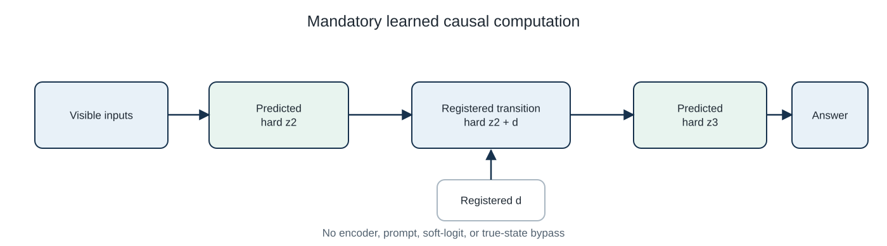
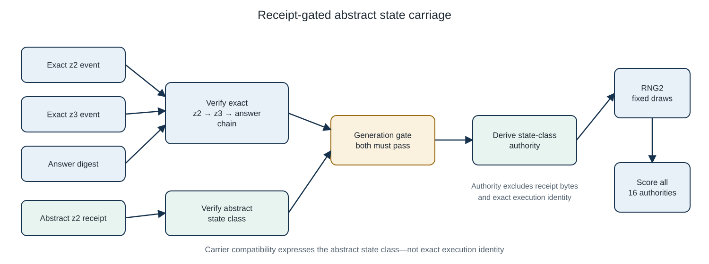
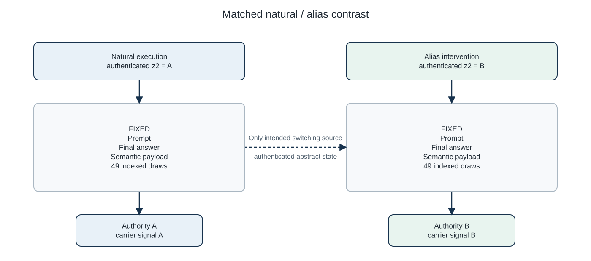
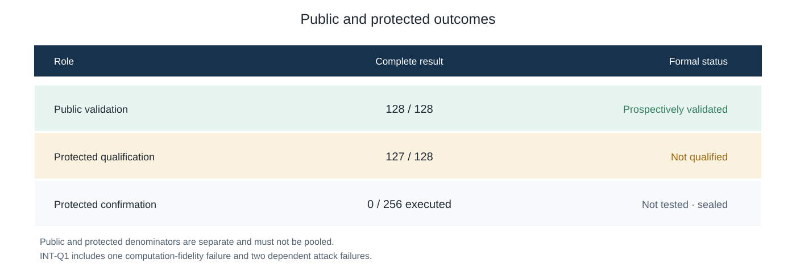

# Authenticated causal-state carriage in generated output

Status: provisional reporting draft pending independent methodological review.

## Abstract

We test whether generated output can statistically carry an authenticated
causal-state class when prompt, answer, semantic payload, generation
configuration, and primitive random draws are held fixed. The proof of concept
uses one selected learned model with a supervised mandatory hard bottleneck,
exact and abstract HMAC receipts, a verified `z2 → z3 → answer` chain, and a
position-indexed stochastic realiser. An answer-preserving intervention
changed the consumed abstract `z2`, its derived authority, and the intended
output signal while preserving the matched controls. A frozen prospective
public validation passed 128/128 closures, with zero registered attack,
carrier-off, or wrong-authority regression events. Protected qualification
did not pass: one of 128 closures failed computation fidelity, yielding a
descriptive 127/128 and two dependent attack failures. Final protected
confirmation was not run. The result establishes bounded architectural
feasibility, not output-only, trust-free, unconstrained-model, or
whole-reasoning provenance.

## 1. Contribution and claim

The central question is:

> Can a statistical signal in generated output track an authenticated,
> causally operative abstract internal state when ordinary visible and
> stochastic explanations of the difference are controlled?

The contribution combines four separately tested components:

1. a learned, mandatory `z2 → z3 → answer` computation;
2. causal state substitution with answer-preserving and answer-changing
   controls;
3. exact-event, abstract-state, and causal-chain receipts; and
4. a calibrated statistical carrier driven by the verified abstract state.

The strongest claim is a prospective **public** proof of concept in this
engineered system. Protected generalisation is not established.

## 2. Relation to prior work

Statistical language-model watermarks alter token sampling so generated text
can later be detected. Kirchenbauer et al. promote keyed “green” tokens and
derive an efficient statistical detector; SynthID-Text likewise modifies the
sampling procedure and evaluates scalable text identification
([Kirchenbauer et al., 2023](https://proceedings.mlr.press/v202/kirchenbauer23a.html);
[Dathathri et al., 2024](https://www.nature.com/articles/s41586-024-08025-4)).
Those systems primarily identify generator-produced content. Here the
statistical authority represents one authenticated internal state class
within a selected computation.

Causal-abstraction methods align neural representations with interpretable
variables and use interchange interventions to test their counterfactual
roles; interchange-intervention training can explicitly induce such structure
([Geiger et al., 2021](https://proceedings.neurips.cc/paper/2021/hash/4f5c422f4d49a5a807eda27434231040-Abstract.html);
[Geiger et al., 2022](https://proceedings.mlr.press/v162/geiger22a.html)).
Our hard bottleneck is deliberately engineered and supervised, so the causal
claim is empirical validation of a mandatory learned substrate—not discovery
of a naturally emergent representation.

Content-provenance standards bind signed assertions to assets and distinguish
cryptographic hard bindings from content-derived soft bindings
([C2PA 2.2](https://spec.c2pa.org/specifications/specifications/2.2/specs/C2PA_Specification.html)).
Our HMAC receipts play a trusted evidence role, while the statistical carrier
acts as a state-class-compatible output signal. The system is not C2PA,
public-key attestation, or output-only verification.

## 3. Method

### 3.1 Mandatory causal computation



During training and inference, the transition consumed predicted hard `z2`
and the answer head consumed predicted hard `z3`. No encoder, prompt, soft
logit, or true-state bypass was registered.

### 3.2 Verification and output carriage



Generation authority became available only after abstract-receipt and
causal-chain verification. It was derived from the state ontology,
model/checkpoint domain, and categorical state—not receipt bytes or exact
execution identity.

### 3.3 Matched natural/alias comparison

| Quantity | Natural versus alias |
|---|---|
| Prompt bytes | Identical |
| Final answer | Identical |
| Semantic payload bytes | Identical |
| Generation configuration | Identical |
| Output indices | Identical |
| Position-indexed primitive draws | Identical |
| Authenticated abstract `z2` | Different |
| Derived state authority | Different |
| Statistical output signal | Expected to switch |



The primary alias intervention overrode only hard `z2`; the model generated
the downstream hard `z3`. A prospectively registered non-alias substitution
required the corresponding answer change, ruling out a downstream module that
simply ignored the intervened state.

### 3.4 Exact and abstract provenance

| Candidate evidence | Exact-execution claim | Abstract-state claim | Carrier compatibility |
|---|---|---|---|
| Correct execution and state | Accept | Accept | Accept |
| Different execution, same state | Reject | Accept | Accept |
| Different registered state | Reject | Reject | Reject |
| Required receipt missing | Abstain | Abstain | No authenticated claim |
| Present but invalid receipt | Reject | Reject | No authenticated claim |

The carrier expresses an abstract state class. It does not independently prove
which exact execution instantiated that class.

## 4. Prospective evaluation

The frozen public operating point was:

```text
T = 4.041451884327381
M = 0.0
8 outputs per side
16 candidate authorities
49 position-indexed draws per output
```

Acceptance required the authenticated score to exceed `T`, uniquely rank
first, and exceed the strongest wrong authority by a margin greater than `M`.
Every closure remained in the denominator; receipt, computation, semantic, or
carrier failures could not compensate for one another.

## 5. Results

| Population | Complete result | Attack failures | Carrier-off regressions | Wrong-authority confusions | Formal status |
|---|---:|---:|---:|---:|---|
| Public INT-V1 | **128/128** | 0 | 0 | 0 | Prospectively validated |
| Protected INT-Q1 | **127/128** | 2 dependent | 0 | 0 | Not qualified |
| Protected INT-C1 | 0/256 executed | — | — | — | Not tested; sealed |



Public INT-V1 comprised 256 natural/alias execution packages, 1,280 receipt
envelopes, 10,240 generated outputs, 501,760 model steps, 163,840 primitive
authority scores, 20,480 aggregate scores, and 1,024 frozen attacks. The
independent evaluator reconstructed the complete primitive-evidence-to-verdict
chain.

Protected Q1 retained the same prospective denominator but one closure failed
computation fidelity and caused two dependent attack-expectation failures.
Release, chronology, evidence commitments, counts, and independent
reconstruction were valid. The positive-only adjudicator lacked an
appropriate scientific-negative terminal and emitted an invalid terminal;
that historical terminal remains unchanged. Protected confirmation was not
authorised.

## 6. Interpretation

The public result supports a bounded demonstration that authenticated causal
state can control a statistical property of generated output under strong
matched controls.

It does not show that:

- a statistical score alone proves exact execution identity;
- the system works without trusted receipts and key custody;
- the state emerged naturally in an unconstrained pretrained model;
- an entire hidden trajectory or chain of thought was authenticated;
- the strict bottleneck recipe was robust across all three original seeds;
- protected generalisation passed;
- the method is equivalent to production SynthID.

## 7. Sidecar baseline

A sidecar HMAC is simpler and cryptographically stronger for authenticating
declared metadata. The additional property demonstrated here is different:
an authenticated causal-state class controls a statistical signal expressed
inside generated output. We do not claim superior cryptographic integrity.

## 8. Reproducibility and review

The immutable evidence commit is
`15e25785eee560cf0242ff781dedb4ea4fc0e809`. Retained evidence can be audited
without model execution, and the public reference evaluator reconstructs the
result from raw rows and revealed keys. The paper remains provisional pending
digest-bound review by an uninvolved researcher.

Detailed chronology, governance failures, denominators, terminal
interpretation, and claim boundaries are in [APPENDICES.md](APPENDICES.md).
The chronology-derived
[evidence hierarchy](figures/figure-4-evidence-hierarchy.svg) keeps formal
positives, valid negatives, protected non-qualification, programme closure,
and sealed evidence visibly separate.

## References

1. Dathathri, S. et al. [Scalable watermarking for identifying large language
   model outputs](https://www.nature.com/articles/s41586-024-08025-4).
   *Nature* 634 (2024).
2. Geiger, A. et al. [Causal Abstractions of Neural
   Networks](https://proceedings.neurips.cc/paper/2021/hash/4f5c422f4d49a5a807eda27434231040-Abstract.html).
   NeurIPS 34 (2021).
3. Geiger, A. et al. [Inducing Causal Structure for Interpretable Neural
   Networks](https://proceedings.mlr.press/v162/geiger22a.html). ICML (2022).
4. Kirchenbauer, J. et al. [A Watermark for Large Language
   Models](https://proceedings.mlr.press/v202/kirchenbauer23a.html). ICML
   (2023).
5. Coalition for Content Provenance and Authenticity.
   [C2PA Technical Specification 2.2](https://spec.c2pa.org/specifications/specifications/2.2/specs/C2PA_Specification.html)
   (2025).
